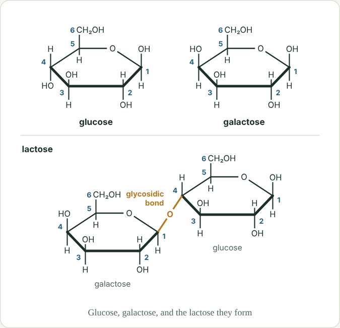
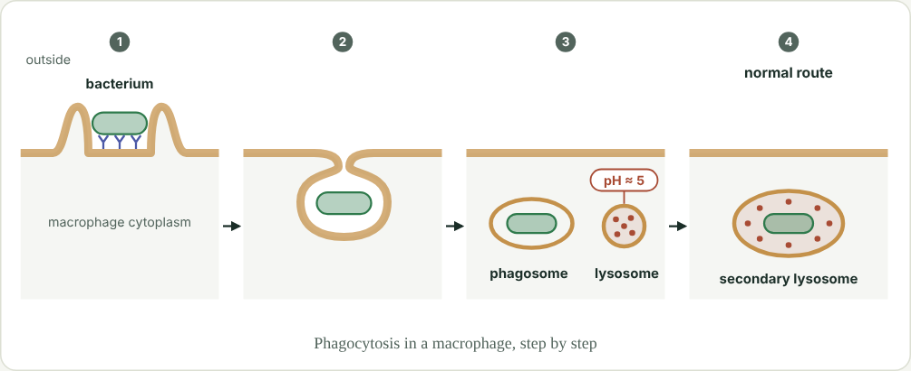
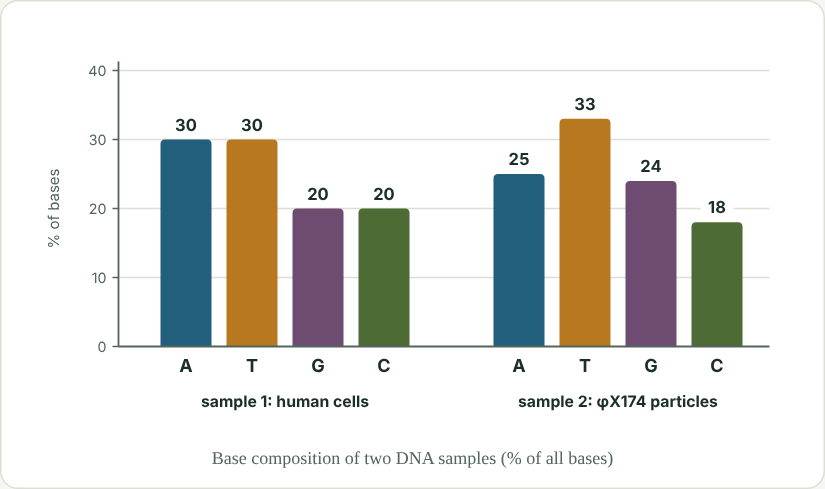
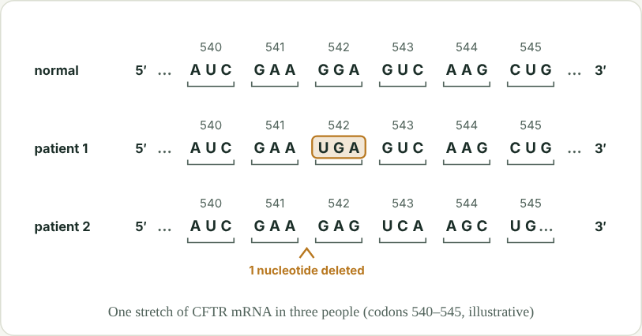

# Worked examples: case-study 보기 cards

These four cards come from the Modules 1–5 case studies, in their final reviewed form exactly as they appear on Eric's study page. Match this style: the length, the tone, how the box is used, what the diagram shows and leaves out, and how concise the explanations are. Each card's diagram is in `docs/example_diagrams/` (open it with the Read tool), and its SVG source is in `ref/live_diagrams.json` under the key given.

Every case card follows the same recipe:

- **One real case** (a disease, drug, lab result, or everyday observation) in a one-to-two-sentence stem that ends with "Using the diagram, which statements in <보기> are correct?"
- **A box with two facts.** (가) usually adds a mechanism detail and (나) a twist or experiment, and a statement uses each of them.
- **Three statements of different kinds:** a misconception trap, an explanation of the case using course concepts, and a what-if that changes one part of the system. Any number of them can be true; the builder balances the answer patterns across the set.
- **A diagram** that shows the system's structure or data, which the statements make you read. It never prints an answer, a rule being tested, or a verdict.
- **Explanations** of one to two sentences per statement, saying why it is true or false.

---

## A milk sugar some babies can't handle  (Module 2 · Carbohydrates · 3점)

*Diagram `lactose_galactose_glucose`: "Glucose, galactose, and the lactose they form"*

**Stem:** Babies with galactosemia can't properly process galactose, so it builds up to harmful levels when they drink milk. Using the diagram, which statements in <보기> are correct?

> **(가)** Lactose, the main sugar in milk, is a disaccharide of glucose and galactose.
>
> **(나)** Babies with galactosemia are fed formula made without lactose.

**<보기>**
- ㄱ. Sweetening the formula in (나) with sucrose is safe for these babies, since digesting sucrose releases no galactose.
- ㄴ. When lactose formed, the -OH on carbon 1 of galactose and the -OH on carbon 4 of glucose reacted, releasing one water molecule.
- ㄷ. Since glucose and galactose differ only in the position of one -OH group, enzymes that act on glucose also act on galactose.

Choices: ① ㄱ　② ㄴ　③ ㄷ　④ ㄱ, ㄴ　⑤ ㄱ, ㄷ  **Key: ④**

- ㄱ **O**: Sucrose is a disaccharide of glucose and fructose, so hydrolyzing it releases no galactose.
- ㄴ **O**: A glycosidic bond forms by condensation between two -OH groups, here at galactose C1 and glucose C4, releasing H2O; digesting lactose adds that water back (hydrolysis).
- ㄷ **X**: Glucose and galactose are isomers (both C6H12O6), and isomers are functionally different: enzymes are specific to each shape.

*Links:* Isomers are functionally different · Glycosidic bonds form by condensation and break by hydrolysis · Sucrose = glucose + fructose · Real-world: galactosemia

**Why it works**

- The case (galactosemia) is the reason every statement matters: a baby can't process galactose, so which sugars are safe is a real decision.
- (나) sets up the what-if (ㄱ, sucrose formula) and the diagram's numbered rings carry the explanation statement (ㄴ, which -OH groups condense).
- The trap (ㄷ) is a real misconception, "isomers behave the same", and it can only be judged by reasoning: the diagram shows the single -OH difference but not what that means for enzymes.
- The diagram shows structure only. It labels the glycosidic bond but prints no formula, no 'isomer' label, and no verdict.

---

## A bacterium that hides inside its hunter  (Module 3 · Bulk Transport · 3점)

*Diagram `macrophage_phagocytosis`: "Phagocytosis in a macrophage, step by step"*

**Stem:** Macrophages engulf Mycobacterium tuberculosis, the bacterium that causes TB, but the bacteria often survive and even multiply inside them, because they stop their phagosome from fusing with a lysosome. Using the diagram, which statements in <보기> are correct?

> **(가)** Lysosomes contain hydrolytic enzymes and keep their interior near pH 5.
>
> **(나)** In the diagram, step 4 shows the normal route after phagocytosis.

**<보기>**
- ㄱ. The bacterium gets inside the macrophage without ever passing through the lipid bilayer of its plasma membrane.
- ㄴ. A drug that restored phagosome-lysosome fusion would help the macrophage kill the bacteria.
- ㄷ. Even without fusion, the bacterium in step 3 is already being digested, because the phagosome around it contains hydrolytic enzymes.

Choices: ① ㄱ　② ㄴ　③ ㄷ　④ ㄱ, ㄴ　⑤ ㄴ, ㄷ  **Key: ④**

- ㄱ **O**: In phagocytosis the membrane wraps around the particle and pinches off, so the bacterium ends up enclosed in a phagosome.
- ㄴ **O**: Fusion would expose the bacteria to the lysosome's hydrolytic enzymes and low pH, as in the normal route.
- ㄷ **X**: A phagosome holds only what was engulfed; the hydrolytic enzymes and low pH arrive when it fuses with a lysosome to form a secondary lysosome (step 4), the step this bacterium blocks.

*Links:* Phagocytosis · Phagosome-lysosome fusion · Bulk transport keeps membranes continuous · Real-world: tuberculosis

**Why it works**

- The case (TB surviving inside macrophages) supplies the puzzle; each statement explains or predicts something about it.
- The diagram is a four-step process, and (나) points at step 4, so the student must compare step 3 with step 4 to reject the trap (ㄷ: the phagosome itself digests).
- ㄱ is a subtle true statement (the bacterium never crosses the bilayer, because membrane wraps it) that tests bulk transport rather than recall.
- In review, an earlier version of ㄷ was replaced because it repeated an existing matching card almost word for word. Always search ref/existing_cards_index.txt.

---

## When A doesn't equal T  (Module 4 · DNA: Evidence & Structure · 3점)

*Diagram `base_composition_chart`: "Base composition of two DNA samples (% of all bases)"*

**Stem:** In 1959, base-composition data like those in the diagram showed that the DNA of φX174, a virus that infects E. coli, is unusual. Using the diagram, which statements in <보기> are correct?

> **(가)** Sample 1 is DNA from human cells; sample 2 is DNA purified from φX174 virus particles.
>
> **(나)** Inside an infected E. coli cell, φX174's DNA is copied to make a double-stranded form.

**<보기>**
- ㄱ. Sample 1's values fit double-stranded DNA, in which every A on one strand pairs with a T on the other, and every G with a C.
- ㄴ. Because A + G and T + C are nearly equal in sample 2, φX174's DNA is double-stranded.
- ㄷ. The double-stranded form in (나) would still contain more T than A, just like the DNA in the virus particles.

Choices: ① ㄱ　② ㄴ　③ ㄱ, ㄴ　④ ㄴ, ㄷ　⑤ ㄱ, ㄴ, ㄷ  **Key: ①**

- ㄱ **O**: Complementary pairing (A-T, G-C) between the two strands forces %A = %T and %G = %C (Chargaff's rules).
- ㄴ **X**: Double-stranded DNA needs A = T and G = C, pair by pair; sample 2 has A 25 vs T 33 and G 24 vs C 18, so its bases aren't paired. A + G (49%) nearly matching T + C (51%) is a coincidence: the DNA in the particles is single-stranded.
- ㄷ **X**: In any double-stranded DNA each A is paired with a T, so the double-stranded form has equal amounts of A and T (and of G and C).

*Links:* Chargaff's rules · Complementary base pairing · Real-world: φX174, a single-stranded DNA virus

**Why it works**

- Real 1959 data (φX174 base composition) make the student reason quantitatively from a chart.
- The trap (ㄴ) is analytical: A + G (49%) nearly equals T + C (51%) by coincidence, but double-stranded DNA needs A = T and G = C pair by pair. A student who memorised "purines = pyrimidines" falls for it.
- (나) (the double-stranded form inside the cell) powers the what-if (ㄷ).
- The chart prints the data and nothing else: no 'single-stranded' label, no Chargaff note.

---

## Reading past an early stop  (Module 5 · Translation Stages: Prok vs Euk · 3점)

*Diagram `stop_codon_mutations`: "One stretch of CFTR mRNA in three people (codons 540–545, illustrative)"*

**Stem:** About one in ten people with cystic fibrosis carries a mutation that turns a codon of the CFTR mRNA into an early stop codon. Drugs such as ataluren were developed to let ribosomes read past early stop codons. Using the diagram, which statements in <보기> are correct?

> **(가)** Patient 1's mutation changes codon 542 from GGA to UGA.
>
> **(나)** Patient 2's mutation deletes one nucleotide from codon 542.

**<보기>**
- ㄱ. Normally, a tRNA whose anticodon pairs with UGA reads a stop codon and ends translation.
- ㄴ. For patient 1, reading through the early UGA would yield a full-length protein.
- ㄷ. The same drug would give patient 2 a normal protein, because in both patients only one nucleotide is affected.

Choices: ① ㄱ　② ㄴ　③ ㄱ, ㄴ　④ ㄴ, ㄷ　⑤ ㄱ, ㄴ, ㄷ  **Key: ②**

- ㄱ **X**: No tRNA reads a stop codon; a protein release factor binds the A site, and the finished chain is released.
- ㄴ **O**: A read-through drug lets a tRNA place an amino acid at the early UGA; the codons after it are still in the original frame, so translation runs on to the normal stop codon.
- ㄷ **X**: Deleting one nucleotide shifts the reading frame, so every codon after it is misread; reading past a single stop can't fix that.

*Links:* Release factors end translation · Reading frame · Real-world: cystic fibrosis and read-through drugs

**Why it works**

- A real drug strategy (read-through of an early stop codon in cystic fibrosis) and two patients make a natural comparison.
- The sequence strips let the student see that patient 1 has one changed codon while patient 2's frame shifts after the deletion. The diagram gives the data; the statements ask what it means.
- The trap (ㄱ) targets a real misconception: that a tRNA reads stop codons. In fact a release factor binds the A site.
- In review the true statement was trimmed, so the single true statement isn't the longest one on the card.

---
